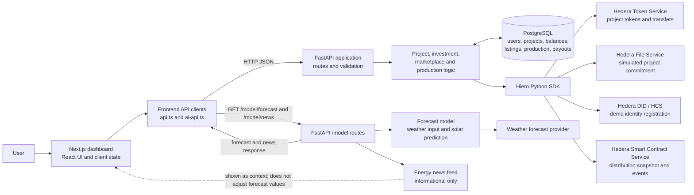

# EnerX

### Frameworks, technologies and languages

[](https://nextjs.org/)
[](https://react.dev/)
[](https://www.typescriptlang.org/)
[](https://tailwindcss.com/)
[](https://pnpm.io/)

[](https://www.python.org/)
[](https://fastapi.tiangolo.com/)
[](https://www.postgresql.org/)
[](https://github.com/hiero-ledger)
[](https://soliditylang.org/)

[](https://alembic.sqlalchemy.org/)
[](https://www.psycopg.org/)
[](https://scikit-learn.org/)
[](https://numpy.org/)
[](https://pandas.pydata.org/)

EnerX is a solar-project crowdfunding and secondary-marketplace MVP. It brings
together a Next.js dashboard, a FastAPI backend, PostgreSQL application data,
Hedera token and file services, a smart-contract distribution record, and an
AI-powered solar-production forecast.

> **MVP / demonstration scope:** Portal users and their configured signing keys
> are simulated. Project equipment and owner commitment data written to Hedera
> File Service are explicitly simulated. The virtual money balance is a
> PostgreSQL demo ledger, not a bank account or on-chain stablecoin. The revenue
> smart contract records a distribution snapshot and emits events; it does not
> transfer real currency. Do not treat this project as a production financial,
> identity, or energy-verification system.

## How the pieces fit together



The user journey is:

1. The dashboard starts with demo UI data, then loads available users,
   verification state, project holdings, projects, and marketplace listings
   from the backend when those requests succeed.
2. A demo user submits identity details. The backend checks them against the
   seeded user record, registers/reuses a Hedera DID, and stores verification
   state in PostgreSQL.
3. A verified owner creates a project. The backend creates its HTS token,
   initially transfers 30 tokens to the owner, publishes a simulated project
   commitment through HFS, then stores project/token/balance metadata.
4. Investors buy from the primary allocation with a virtual balance. HTS moves
   tokens from the operator treasury to the investor; PostgreSQL records the
   purchase, balances, and transaction ID.
5. Token holders may list tokens on the marketplace. On purchase, the backend
   transfers tokens from seller to buyer on HTS and moves virtual balance
   between their PostgreSQL records.
6. A production submission stores kWh and revenue, takes a snapshot of
   PostgreSQL token holdings, and records the allocation on the configured
   Hedera smart contract. After Hedera confirms the contract call, the backend
   stores payout records and credits the demo virtual balances.
7. The AI forecast endpoint obtains weather forecast input and predicts solar
   production. The news feed is informational; it does not change forecast or
   dividend calculations.

## Repository layout

```text
.
├── frontend/                 # Next.js dashboard and browser API clients
│   ├── app/                  # App Router pages and news route
│   ├── components/enerx/     # Dashboard, investment, owner and AI UI
│   └── lib/enerx/            # API clients, types, demo data and forecast UI
└── backend/                  # FastAPI API, database and Hedera integrations
    ├── app/routes/           # Auth, project, investment, user, marketplace,
    │                         # production and model endpoints
    ├── app/services/         # Production/revenue allocation logic
    ├── hedera/               # Hiero SDK client and DID, HTS, HFS, HSCS helpers
    ├── contracts/            # RevenueDistribution.sol
    ├── model/                # Solar forecast and news modules
    ├── alembic/              # PostgreSQL schema/data migrations
    └── tests/                # Backend tests
```

## Backend API overview

The interactive OpenAPI page at `/docs` is the source of truth for schemas.
The main routes currently used by the frontend are:

| Method | Route | Purpose |
| --- | --- | --- |
| `GET` | `/` | API status |
| `GET` | `/user/{user_id}` | User, token holdings and owned projects |
| `GET` | `/auth/verification/{user_id}` | User identity/verification state |
| `POST` | `/auth/did` | Demo identity match and Hedera DID creation/reuse |
| `GET` | `/project/` | List projects |
| `POST` | `/project/` | Create project, HTS token and HFS commitment |
| `GET` | `/investment/{investor_id}` | List investment records |
| `POST` | `/investment/` | Buy primary-market tokens |
| `GET` | `/marketplace/listings` | List active marketplace offers |
| `POST` | `/marketplace/list` | Create a token listing |
| `POST` | `/marketplace/list/buy` | Buy some or all of a listing |
| `DELETE` | `/marketplace/list/{listing_id}?user_id=...` | Cancel a listing |
| `POST` | `/prod` | Record production and submit distribution snapshot |
| `GET` | `/model/forecast` | AI solar-production and revenue forecast |
| `GET` | `/model/news` | Informational energy news |

The frontend also contains fallback demo data for some initial views; a
successful API connection is needed for backend-backed project and transaction
flows. Forecast and news requests use the integrated `/model` endpoints by
default. For all API operations, the backend validates the request and reports
errors as non-2xx responses (usually with a FastAPI `detail` field).

## Important product and integration boundaries

- **Token allocation:** project token total is 100; the owner receives 30,
  leaving up to 70 for primary-market buyers. The backend HTS helper creates
  tokens with two decimal places and transfers token quantities in hundredths;
  the product treats shares as whole-token units.
- **Primary investment:** demo currency is stored in PostgreSQL. The HTS token
  transfer is a real Hedera transaction when valid credentials/network access
  are configured.
- **Secondary market:** the listing is stored in PostgreSQL; HTS transfers
  tokens seller-to-buyer while virtual funds move buyer-to-seller in the
  database.
- **Identity:** `GET /auth/{user_id}` and seeded portal records are demo
  conveniences, not user authentication. The identity flow is not production
  KYC. Do not expose demo credentials or trust a client-supplied user ID as
  authorization.
- **Project record:** HFS stores a public, immutable record, but the equipment
  and acknowledgement are explicitly simulated and are not independently
  verified or cryptographically signed by the owner.
- **Revenue:** the backend snapshots token holdings and calculates allocations
  to the cent. The smart contract checks and records the allocation, emitting
  events; it does not itself transfer currency. The database credits virtual
  balances after the contract transaction succeeds.
- **Forecast:** model output is an estimate based on weather input and the
  included model. It is not measured production or a guarantee of revenue.
  News is informational and is not used to alter the returned forecast.

## Checks

Backend tests (from `backend/`):

```bash
uv run pytest
```

Frontend production build (from `frontend/`):

```bash
pnpm build
```

More subsystem-specific setup and API details are in the
[backend README](backend/README.md) and
[frontend README](frontend/README.md).
